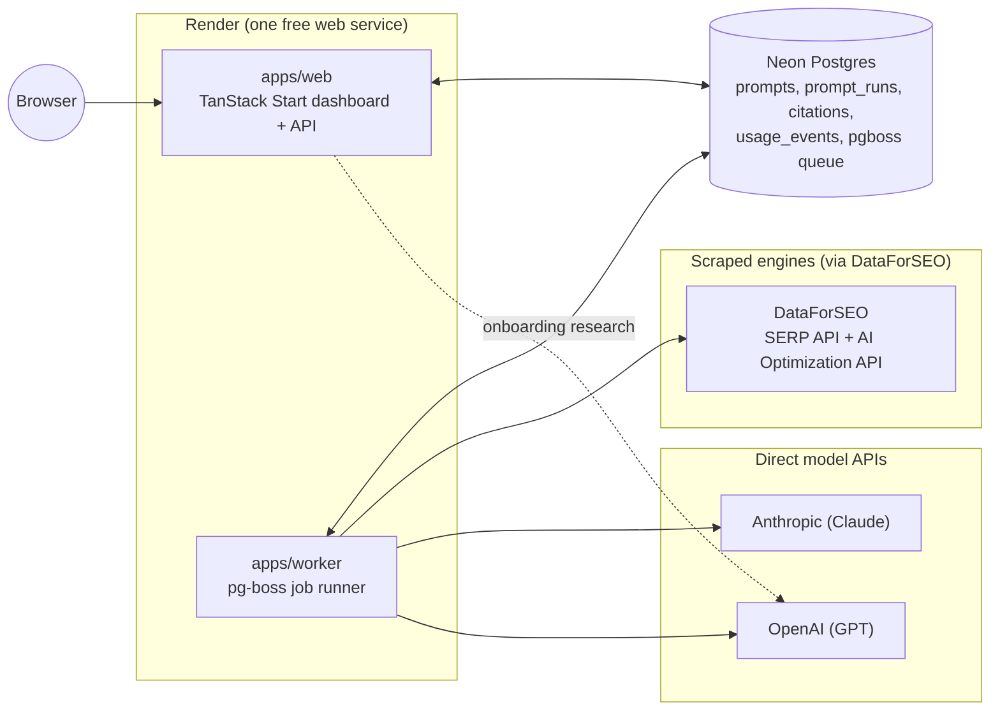
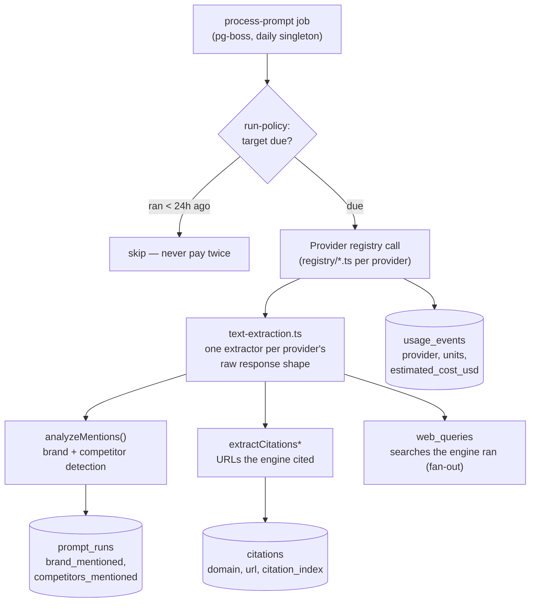

# Enrigio architecture — calculations and external services

How a prompt becomes a visibility score, exactly where each number comes from,
and every external service the system talks to. Backed by a knowledge graph of
the calculation core (9,601 nodes across `packages/lib`, `packages/config`,
`apps/worker`) — regenerate the interactive version locally with `/graphify`;
outputs land in `graphify-out/` (`graph.html`, `GRAPH_REPORT.md`, gitignored).

## System overview



The web app and worker share one process tree on Render and one Neon database.
The queue **is** the database (pg-boss schema `pgboss`), so there is no
separate message broker.

## The evaluation pipeline

Every enabled prompt gets one cycle per day (`process-prompt` job, singleton
per prompt, rescheduled +24h on completion). One cycle fans out to every
target in `SCRAPE_TARGETS` — ours is 7 targets — and runs each target
`standardRunsPerDay` times (5 in local mode) because a single AI answer is a
coin flip; five samples make the mention rate a measurement.



Each stored run is the atom every metric is computed from.

## How the calculations work

**Mention detection** (`packages/lib/src/mentions.ts`) is deliberately blunt:
case-insensitive substring match over the subject's name, aliases, and bare
normalized domains (`www.` stripped). No word boundaries, no link parsing —
engines write prose, and "acme.com is the pick here" or "Acme's" is exactly
the signal. Competitors are matched the same way, which is why they must be
configured *before* a run: tagging happens at evaluation time (citations, by
contrast, re-categorize retroactively).

**AI Visibility** (`apps/web/src/lib/postgres-read.ts`) — the share of runs
that mention the brand, computed in SQL over the filter window:

```
visibility = count(runs WHERE brand_mentioned) × 100 / count(runs)
```

Our first Rigosis cycle: 124 of 170 runs mentioned the brand → 73%.

**Share of Voice** (`packages/lib/src/report-metrics.ts`) — the brand's slice
of all recognized brand mentions:

```
SoV = brand_mentions × 100 / (brand_mentions + competitor_mentions)
```

Per prompt via `computePromptSoV`, overall via `computeOverallSoV`; `null`
(not 0) when nobody at all was mentioned — silence is not a score. Only
*configured* competitors count in the denominator, which is why SoV read 100%
until İnnova, KoçSistem, and Netaş were added.

**Citations** (`packages/lib/src/text-extraction.ts`) — every URL an engine
grounds its answer on, with `citation_index` preserving its position in the
answer. Aggregations: citation counts per domain, and average position
(`avg(citation_index)` — lower means cited earlier, i.e. trusted more).

**Query fan-out** — scraped engines report the web searches they ran before
answering; stored per run as `web_queries` and aggregated by
`analyzeWebQueries` to show how engines rewrite your wording.

**Time series** are LVCF-smoothed (last value carried forward, per prompt) so
a day where a prompt didn't run draws a flat line instead of a hole.

**Cost tracking** — every provider call writes a `usage_events` row with
`estimated_cost_usd`; that table is the source of the per-run cost figures in
[how-to/HOW-TO.md](how-to/HOW-TO.md#what-it-costs).

## External services

| Service | Role | Required | Auth |
|---|---|---|---|
| **Neon** (Postgres 18) | All state: app tables + pg-boss queue + drizzle migrations | yes | `DATABASE_URL` |
| **Render** | Hosting (web + worker in one free service) | yes (demo) | — |
| **DataForSEO** | Scrapes ChatGPT, Google AI Overviews, Google AI Mode, Gemini, Perplexity (SERP API + AI Optimization API) | yes for scraped engines | `DATAFORSEO_LOGIN`/`_PASSWORD` (basic auth) |
| **Anthropic** | Claude answers (direct target) | per `SCRAPE_TARGETS` | `ANTHROPIC_API_KEY` |
| **OpenAI** | GPT answers (direct target) + onboarding brand research (first choice in `RESEARCH_PROVIDER_PREFERENCE`) | per `SCRAPE_TARGETS` | `OPENAI_API_KEY` |
| OpenRouter / Mistral | Alternative direct-model routes | optional | respective keys |
| Cloro / BrightData / Oxylabs / Olostep | Alternative scrapers (each has its own extractor in `text-extraction.ts`) | optional | respective keys |
| Stripe, Resend, Auth0 | Billing, email, SSO — **cloud/whitelabel modes only**, fully dormant in local mode | no | — |
| Sentry / PostHog / Plausible / Clarity | Telemetry — disabled in the demo (`DISABLE_TELEMETRY=1`) | no | — |

Provider selection is one env var: `SCRAPE_TARGETS` =
`model:provider[:version][:online]`, comma-separated. Adding or removing an
engine is an env edit, not a deploy.

## Cost-control design (worth knowing before touching the scheduler)

Three guards keep provider spend deterministic:

1. `run-policy` skips any target that ran inside its frequency window — a
   forced re-run executes nothing it already paid for today.
2. `expedite` (`packages/lib/src/expedite.ts`) only drags a *stalled* job
   forward, never a healthy one between cycles, and refuses jobs carrying a
   failure streak (their delay is deliberate backoff).
3. Every call is metered into `usage_events` before results are processed, so
   failed runs still account for their spend.
