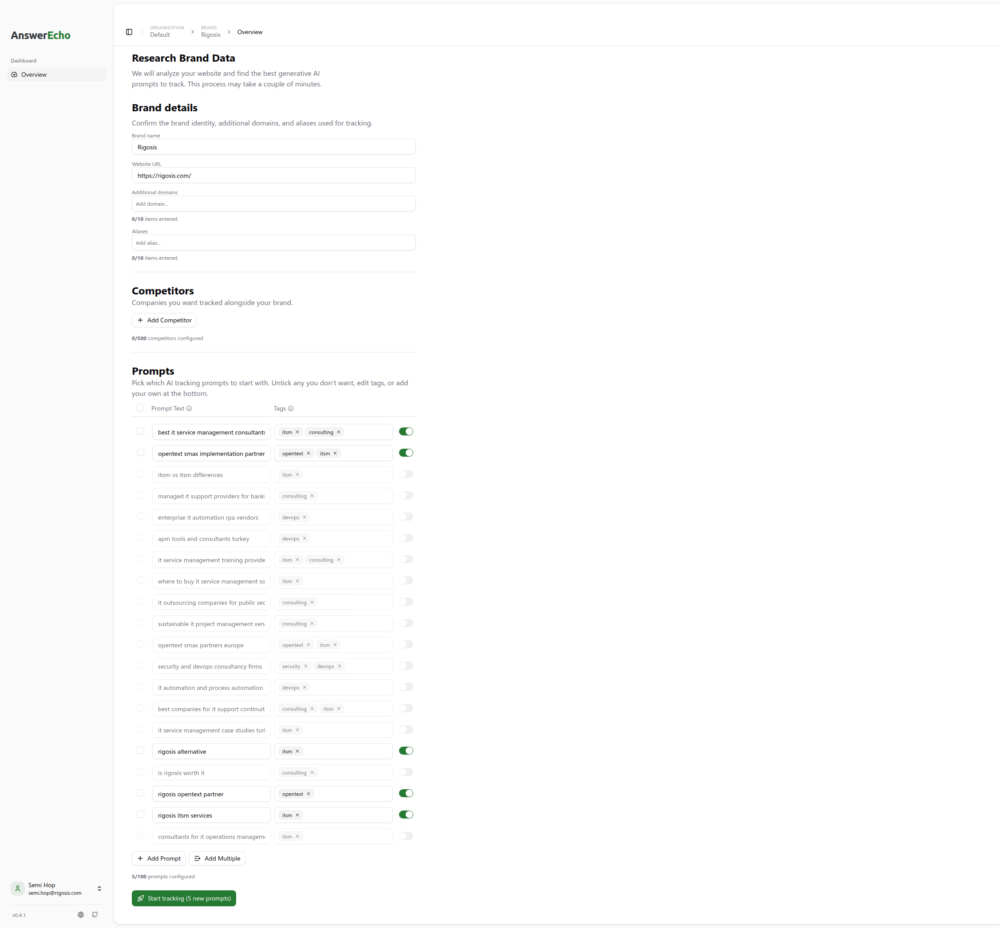
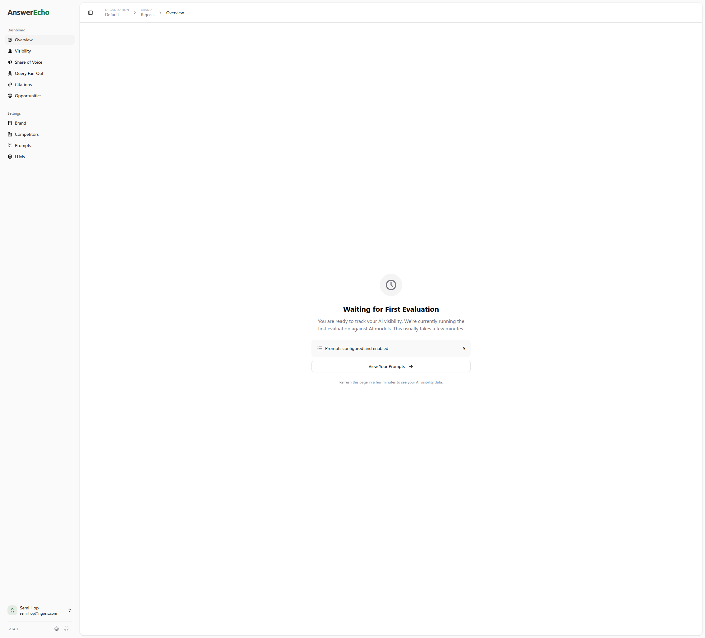
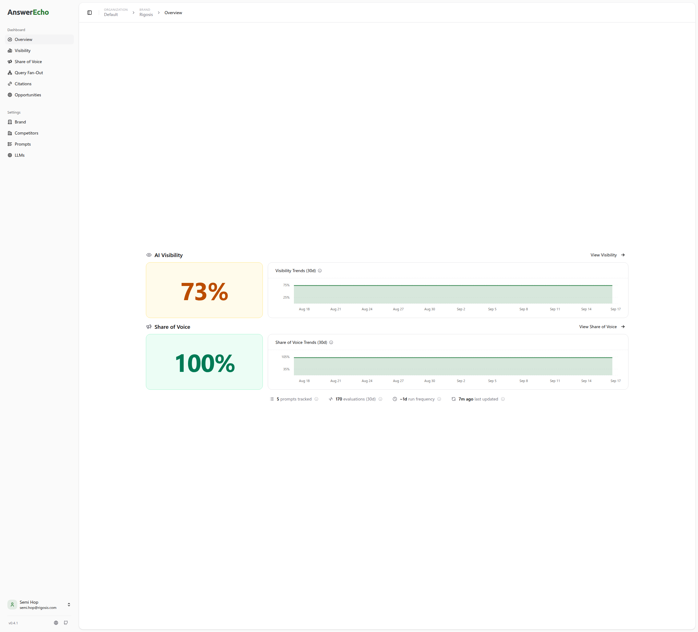
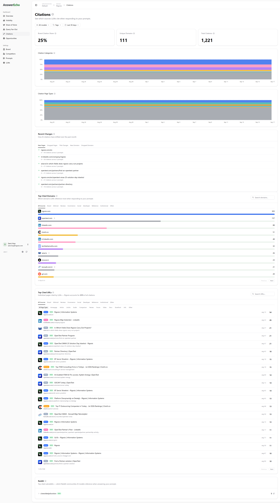

# AnswerEcho — how to use it

A walkthrough of the full flow, captured live on the demo
([answerecho-demo.onrender.com](https://answerecho-demo.onrender.com)) on
2026-09-17 with the Rigosis brand. Every screenshot below is from that real
session — real evaluations against ChatGPT, Google AI Overviews, Google AI
Mode, Gemini, Perplexity, Claude, and GPT.

## 1. Create the admin account

The first visit redirects to sign-up. Local mode has exactly one open
registration: the owner account. Once it exists, sign-up closes.

## 2. Create a brand

A brand is the thing you track: name plus website. Everything else is derived
from it.

## 3. Let the AI analyze the brand

Click **Analyze brand** and AnswerEcho researches the website with web search
(≈1 minute). For rigosis.com it came back with 20 prompt suggestions matched
to the actual business — ITSM consulting in Turkey, OpenText SMAX
partnerships, plus brand prompts like "rigosis alternative". Untick what you
don't want; each enabled prompt is evaluated daily against every configured
engine, so start small (we kept 5).

## 4. Start tracking

**Start tracking** queues the first evaluation run immediately. The worker
fans each prompt out to all engines — scraping ChatGPT, AI Overviews, AI
Mode, Gemini, and Perplexity via DataForSEO, and calling Claude and GPT
directly. A full run takes a few minutes per prompt; results then refresh
every 24 hours automatically.

## 5. Read the overview

Two headline numbers: **AI Visibility** (how often AI answers mention the
brand) and **Share of Voice** (the brand's slice of all brand mentions in
those answers). Our first run: 73% visibility, 100% share of voice, from 170
evaluations.

## 6. Drill into visibility per prompt

This is where the story is. Brand-named prompts ("rigosis itsm services",
"rigosis opentext partner") score 91–100% — ask an AI about Rigosis and it
answers about Rigosis. The generic category prompt ("best it service
management consultants in turkey") found **no brands at all**: nobody owns
that answer yet. That gap is the AEO opportunity this tool exists to surface.

## 7. See who gets cited

Citations shows which domains and pages the engines relied on when answering
(1,221 collected in the first run). Domains you don't control that rank for
your prompts are your content and PR targets.

## 8. Manage prompts over time

Settings → Prompts is where you add, tag, disable, or bulk-import prompts
later. Each enabled prompt costs one evaluation per engine per day, so prune
what you don't read.

---

### Operating notes (demo environment)

- Free-tier Render sleeps after ~15 idle minutes; evaluations only process
  while the service is awake. Open the dashboard to wake it.
- Scrapes occasionally fail with a DataForSEO "Internal SE Server Error" —
  transient upstream errors; the daily rerun picks them up.
- Deploys restart the service; avoid pushing while a run is in flight.
