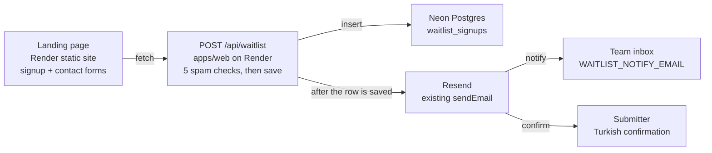

# Landing waitlist backend — design

2026-11-10 · Status: parked (2026-11-10) — forms stay unwired until this is picked up

## Summary and goals

The landing page at [enrigio-landing.onrender.com](https://enrigio-landing.onrender.com) gets one public endpoint in the existing Enrigio app. It saves both landing forms to a new Postgres table, emails the team, and sends each person a Turkish confirmation. There's no new vendor and no extra monthly cost.

**Goals**

- Save every real early-access signup (site + email) and contact request (name, email, company, phone, scope, note) in Neon, where it can be queried later.
- Keep the list usable for the launch-day promise in the banner: every signup gets a free measurement.
- Stop bulk form spam without adding a CAPTCHA.
- Show the success screen only after the submission is actually saved.

**Out of scope**

- An admin screen for the list. Query Neon directly for now.
- Double opt-in, and running starter reports automatically for signups.
- A CAPTCHA. Cloudflare Turnstile is the fallback if spam gets through (see [Spam and abuse protection](#spam-and-abuse-protection)).

## Architecture



The browser posts straight to the existing app; nothing new is hosted. A request that fails a spam check stops at the endpoint and never reaches Neon or Resend.

## Data model

One table, `waitlist_signups`, holds both forms; `kind` tells them apart. It's added to `packages/lib/src/db/schema.ts` with a Drizzle migration (`0029_waitlist_signups.sql`). The Render deploy applies the migration when the PR merges to `main`.

| Column | Type | Rule |
| --- | --- | --- |
| `id` | uuid | primary key, `gen_random_uuid()` |
| `kind` | text | `signup` or `contact` (check constraint) |
| `email` | text | required, stored lower-cased and trimmed |
| `site` | text | signup: required, normalised domain (no scheme or path) |
| `name` | text | contact: required, at least two words |
| `company` | text | contact: required |
| `phone` | text | contact: optional |
| `scope` | text | contact: optional |
| `note` | text | contact: optional, max 2000 chars |
| `ip_hash` | text | HMAC-SHA256 of the client IP, keyed with `BETTER_AUTH_SECRET`; used for rate limiting |
| `user_agent` | text | max 300 chars, for spam forensics |
| `confirmation_sent_at` | timestamptz | null until the confirmation email goes out |
| `created_at` | timestamptz | default `now()` |

**Indexes and constraints**

- Unique on (`kind`, `email`) for `signup` only (a partial index). A repeat signup is treated as success and sends no second email. The contact form allows repeats.
- Index on (`ip_hash`, `created_at`) for the rate-limit count.

Only a hash of the IP address is stored, never the raw address, to keep personal data to a minimum under KVKK and GDPR.

## API contract

`POST /api/waitlist` is a public route in `apps/web` (`src/routes/api/waitlist/index.ts`). It takes JSON and needs no auth. `OPTIONS` on the same path answers the CORS preflight.

**Request body**

```json
{
  "kind": "signup",
  "email": "ad@sirketiniz.com",
  "site": "siteniz.com",
  "company_url": "",
  "elapsed_ms": 8200
}
```

- `kind: "contact"` sends `name`, `company`, `phone`, `scope`, `note` in place of `site`.
- `company_url` is the honeypot. `elapsed_ms` is the time since the page loaded. Both are explained in [Spam and abuse protection](#spam-and-abuse-protection).
- Body capped at 8 KB. Unknown fields are ignored.
- The server repeats the landing page's own validation: the same email and domain regexes, and the same rules for name, company and site.

**Responses**

| Status | Body | When |
| --- | --- | --- |
| 200 | `{"ok":true}` | saved, a duplicate signup, or a silently dropped bot |
| 400 | `{"ok":false,"errors":{"email":"…"}}` | a field failed validation; messages are in Turkish, keyed like the page's own error fields |
| 403 | `{"ok":false}` | `Origin` not on the allowlist |
| 413 | `{"ok":false}` | body over 8 KB |
| 429 | `{"ok":false,"errors":{"form":"…"}}` | rate limit hit; Turkish "try again later" |
| 500 | `{"ok":false,"errors":{"form":"…"}}` | database write failed |

Bots get a 200 so they get no signal to adapt. A failed confirmation or notification email doesn't fail the request: the row is already saved, and the error is logged.

**CORS**

- Allowed origins come from `WAITLIST_ALLOWED_ORIGINS` (comma-separated), set to `https://enrigio-landing.onrender.com` plus `http://localhost:8765` for local tests.
- The response sets `Access-Control-Allow-Origin` to the matching origin, with `Vary: Origin`, methods `POST, OPTIONS`, and header `Content-Type`. No credentials.

## Spam and abuse protection

Five server-side checks run in order, cheapest first. A request is saved only if all five pass. None of them needs a CAPTCHA or a new service.

| # | Check | Rule | On failure |
| --- | --- | --- | --- |
| 1 | Origin | `Origin` header is on `WAITLIST_ALLOWED_ORIGINS` | 403 |
| 2 | Honeypot | `company_url` is empty; the field is off-screen and `aria-hidden`, with `tabindex=-1` and `autocomplete=off` | 200, not saved |
| 3 | Timing | `elapsed_ms` ≥ 2000 | 200, not saved |
| 4 | Rate limit | ≤ 5 saved rows per `ip_hash` in the last hour, counted in the table itself | 429 |
| 5 | Email | valid format, not on the disposable-domain list (`isDisposableEmail`) | 400 with a Turkish message |

The origin check stops other websites from posting through the form. A script calling the endpoint directly can get past it, which is why checks 2–5 exist. The client IP is the first entry of `X-Forwarded-For`, which Render sets.

**Confirmation-email abuse**

Because we email whoever is named in the form, someone could type a stranger's address. The design limits this in three ways:

- Only a row that passes all five checks sends a confirmation.
- At most one confirmation per address, ever: a duplicate signup sends nothing. The contact form sends at most one confirmation per address per 24 hours.
- The rate limit caps one source at 5 emails an hour.

The confirmation contains no links and no text the submitter wrote, so it can't be used to deliver someone else's content.

**Fallback**

If spam rows appear anyway, add Cloudflare Turnstile: its free, usually invisible widget goes on the page, and its token is verified on the server as check 0. This isn't built now.

## Emails

Both emails go through the existing `sendEmail` (Resend) in `packages/deployment/src/email.ts`, from `RESEND_FROM_EMAIL`. The templates sit next to the existing ones in `email-templates.ts`. The emails are sent after the row is saved. A send failure is logged and doesn't affect the response.

| Email | To | When | Content |
| --- | --- | --- | --- |
| Team notification | `WAITLIST_NOTIFY_EMAIL` | every saved row | subject `Yeni erken erişim: <site>` or `Yeni iletişim talebi: <company>`; every field, plain text, `Reply-To` set to the submitter |
| Confirmation | the submitter | first saved signup per address; contact at most once per 24 h | Turkish, no links, no text the submitter wrote (below) |

**Confirmation copy (signup)**

> Konu: Enrigio erken erişim listesindesiniz
>
> Merhaba, Enrigio erken erişim listesine katıldığınız için teşekkürler. Açılış günü size ücretsiz ölçüm hakkınızı içeren bir e-posta göndereceğiz. Bu kaydı siz yapmadıysanız bu e-postayı yok sayabilirsiniz.

**Confirmation copy (contact)**

> Konu: Talebinizi aldık
>
> Merhaba, Enrigio ekibine ulaştığınız için teşekkürler. Talebinizi aldık ve en kısa sürede size döneceğiz. Bu talebi siz göndermediyseniz bu e-postayı yok sayabilirsiniz.

The "ignore this if it wasn't you" line is what makes an abused send harmless to the stranger who receives it. The copy is a draft for you to edit.

## Landing page changes

The page keeps its design. Only the two submit handlers in `landing/index.html` change: each now waits for the endpoint before showing success.

1. Record `loadedAt = Date.now()` when the component first mounts.
2. Add a hidden `company_url` input to both forms. It sits off-screen with `position:absolute; left:-9999px`, `aria-hidden="true"`, `tabindex="-1"` and `autocomplete="off"`, so screen readers and keyboard users never reach it.
3. `submitSignup` and `submitContact` keep their client-side validation, then `fetch` the endpoint with `kind`, the fields, `company_url` and `elapsed_ms`.
4. While waiting, the submit button is disabled and its label reads `Gönderiliyor…`. A double click can't send twice.
5. On `ok:true`, show the existing success screen (`contactDone` / the signup success state).
6. On 400, put each returned message into the matching existing error slot (`siteErr`, `emailErr`, `cErr[field]`).
7. On 429, 500 or a network failure, show one Turkish line under the form: `Şu anda gönderemedik, lütfen birkaç dakika sonra tekrar deneyin.` The form keeps what the person typed.

The endpoint URL is one constant at the top of the page script, pointing at the production app's `/api/waitlist`.

## Configuration, rollout and testing

**New environment variables** on the `enrigio` Render web service (optional in env validation, so local and self-hosted setups don't break):

| Variable | Value |
| --- | --- |
| `WAITLIST_ALLOWED_ORIGINS` | `https://enrigio-landing.onrender.com` |
| `WAITLIST_NOTIFY_EMAIL` | the team inbox (open question) |

If either is unset, the endpoint returns 404: in local and self-hosted modes the waitlist doesn't exist.

**Rollout**

1. PR to `main`: schema, migration, endpoint, templates and tests. You review the migration SQL.
2. Set the two env vars on Render, then merge. The deploy applies `0029`.
3. Second commit on `landing-page`: the page wiring, pointed at the production endpoint.
4. Smoke test on production: one real signup, one contact request, one duplicate and one honeypot hit. Then delete the test rows.
5. Merge `landing-page` into `main` and switch the static site's branch to `main`.

**Tests** (Vitest, for observable behaviour)

- A valid signup and a valid contact request are saved and return 200.
- Invalid fields return 400 with the right field keys; a disposable domain is refused.
- A repeat signup returns 200, saves no second row and sends no second confirmation.
- A filled honeypot or `elapsed_ms` < 2000 returns 200 and saves nothing.
- A sixth submission from one IP within an hour returns 429.
- A wrong `Origin` returns 403; an allowed origin gets the matching CORS headers.
- A failed email send still returns 200, with the row saved.

## Open questions

- [ ] Which address gets the team notifications (`WAITLIST_NOTIFY_EMAIL`)?
- [ ] Is the production app URL for the endpoint `https://enrigio.onrender.com`, or a custom domain?
- [ ] Is the Turkish confirmation copy approved as written?
- [ ] Is 5 an hour per IP right? Office networks share one IP, so a team signing up together could hit it.
